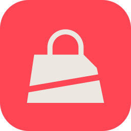
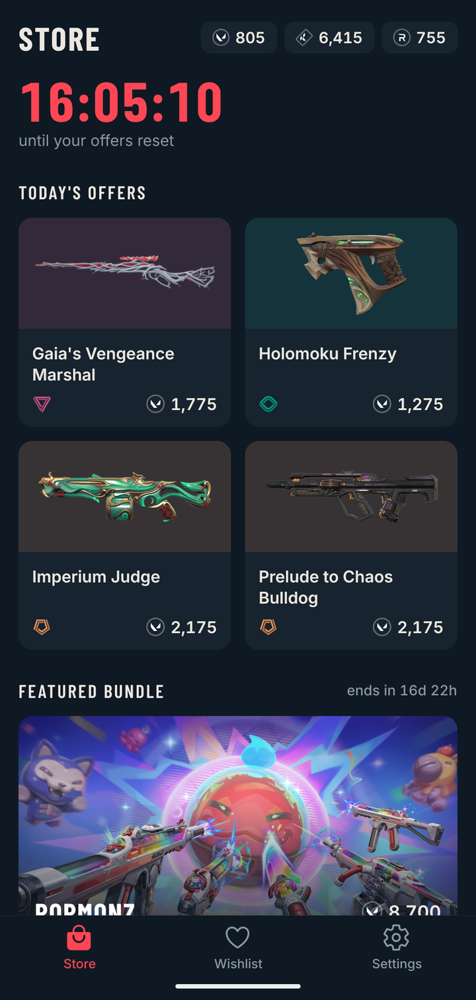
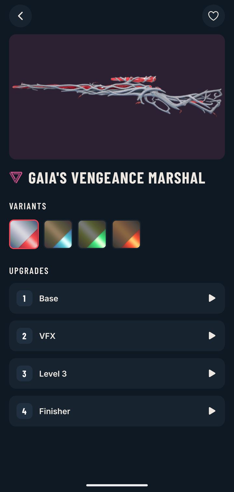
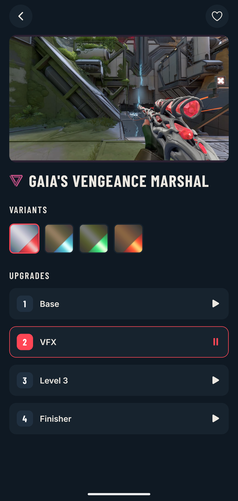
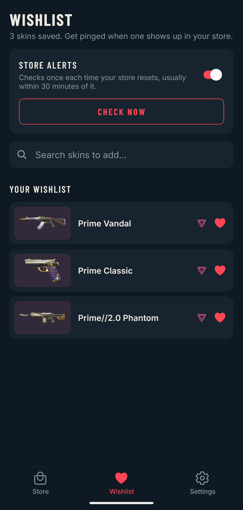

<div align="center">



# Val Store

Check your VALORANT store from your phone, without opening your PC.

<a href="https://sabari50312.github.io/Valo-Store-Tracker/"></a>
&nbsp;
<a href="https://github.com/sabari50312/Valo-Store-Tracker/releases/latest"></a>

**Website:** any phone or computer, iPhone included. Nothing to install.<br>
**Android app:** stays signed in and sends wishlist alerts.

<br>

&nbsp;
&nbsp;
&nbsp;


[Use the website](#use-the-website) · [Install the Android app](#install-the-android-app) · [Is it safe?](#is-it-safe) · [Wishlist alerts](#wishlist-alerts) · [Development](#development)

</div>

## Features

- **Daily store**, **night market**, **featured bundle** and the **accessory store**, with a countdown to the next reset
- **Wallet**: your VP, Kingdom Credits and Radianite
- **Skin previews**: tap any skin to see its variants and watch the in-game video for every upgrade level
- **Wishlist alerts** (Android app): pick the skins you want and get a notification when one shows up in your store

> Val Store is a fan-made app. It isn't affiliated with or endorsed by Riot Games. VALORANT and Riot Games are trademarks of Riot Games, Inc.

## Use the website

Open **[sabari50312.github.io/Valo-Store-Tracker](https://sabari50312.github.io/Valo-Store-Tracker/)** in any browser.

Browsers don't let one site read another site's page, so signing in takes one extra step:

1. Tap **Sign in with Riot**, then **Open Riot login**. Riot's login opens in a new tab.
2. Log in. You'll land on a playvalorant.com page that says it can't be found. That's expected.
3. Copy that page's link: **Share → Copy** on a phone, or copy it from the address bar.
4. Go back to the Val Store tab and tap **Use copied link**.

Riot's login lasts about an hour on the website, so you'll repeat this when it runs out. Riot usually remembers you, so it's quick.

## Install the Android app

1. On your Android phone, open the [latest release](https://github.com/sabari50312/Valo-Store-Tracker/releases/latest) and tap `val-store-x.y.z.apk` under **Assets** to download it.
2. Open the downloaded file. If asked, allow your browser to install apps. Needs a 64-bit phone (any Android phone from roughly the last six years).
3. Open Val Store and sign in with your Riot ID and password. Google and Apple sign-in aren't supported.

New versions install over the old one and keep you signed in.

## Is it safe?

- **Your password never touches Val Store.** You sign in on Riot's own login page. Val Store doesn't see, read or store your username or password.
- **No servers, no tracking.** There's no Val Store backend, account, analytics or ads. Your session and wishlist stay on your phone, or in your browser on the website.
- **Read-only.** Val Store only looks at your store and wallet. It never buys, spends or changes anything on your account.
- **Sign out any time** in Settings, which removes your session from your phone or browser.
- **Open source.** All of Val Store's code is in this repository, so anyone can check these claims.

Read the full [privacy policy](PRIVACY.md).

As with any unofficial app, use it at your own risk. Riot can change things on their side at any time, which may stop Val Store working until it's updated.

## Wishlist alerts

Android app only. In the **Wishlist** tab, search for skins and tap the heart. Then turn on **Store alerts**. Val Store checks once each time your store resets and notifies you if anything on your wishlist is in it.

Alerts usually arrive within about 30 minutes of the reset. Android decides the exact timing, and battery saver can delay it. If alerts don't arrive, set Val Store's battery usage to **Unrestricted** in Android settings.

---

## Development

```bash
npm ci
npx expo start --tunnel ngrok
```

Scan the QR code with Expo Go. Background alerts are best tested in a release build.

Press `w` in the dev server, or run `npx expo start --web`, to open the web version. Web-only code lives in `*.web.ts(x)` files next to their native versions (`RiotLogin`, `auth`, `alerts`, `kv`).

### Website

`.github/workflows/web.yml` builds the web version and publishes it to GitHub Pages on every push to `main`. One-time setup: **Settings → Pages → Source: GitHub Actions**.

### Releases

`.github/workflows/release.yml` builds a signed APK on GitHub's runners and publishes it as a GitHub Release. Start it either way:

- **From GitHub:** Actions tab → **Release APK** → **Run workflow**, enter a version like `1.2.0`. Leave the version empty for a test APK (downloadable from the run, no release).
- **From the terminal:** `git tag v1.2.0 && git push origin v1.2.0`

Don't use **Draft a new release** on the Releases page; the workflow creates the release itself.

- The version becomes versionCode `10200` for `1.2.0` (`app.config.js`). Always increase it, or Android won't install over the older APK.
- Test builds are version `0.0.<run number>`. Their low versionCode means they won't install over a released version; uninstall first.
- Release builds are signed by `plugins/withReleaseSigning.js` using these repository secrets:

  | Secret | Value |
  |---|---|
  | `ANDROID_KEYSTORE_BASE64` | the keystore, base64-encoded |
  | `ANDROID_KEYSTORE_PASSWORD` | keystore and key password |
  | `ANDROID_KEY_ALIAS` | key alias |

Keep a backup of the keystore. Every update must be signed with the same key, or it can't be installed over the existing app.

## License

[MIT](LICENSE)
